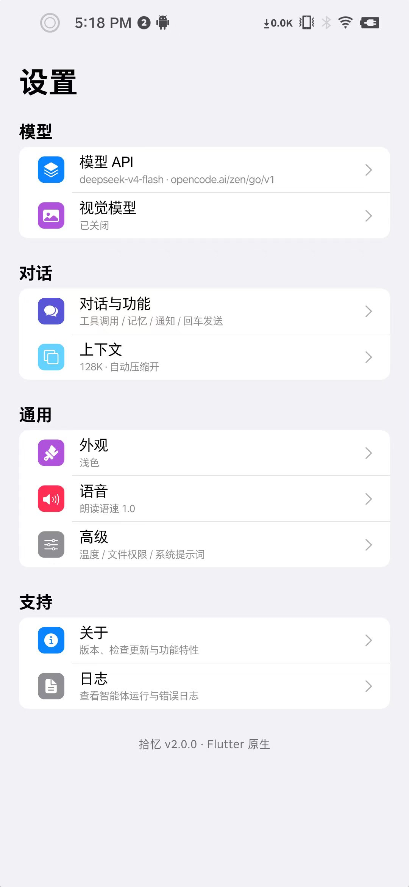
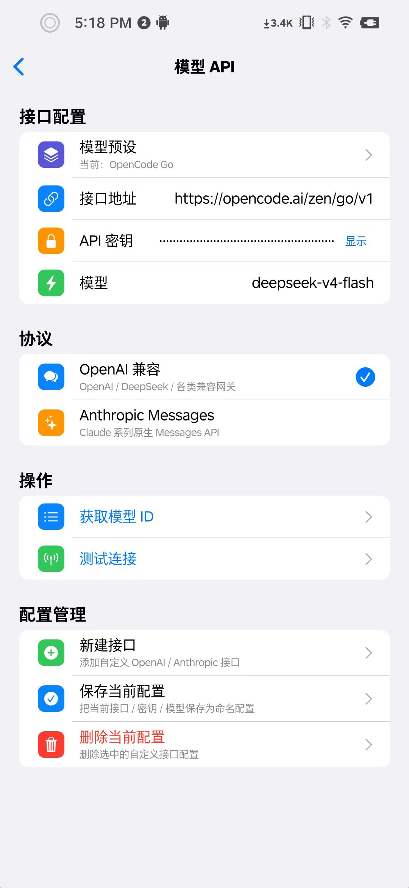
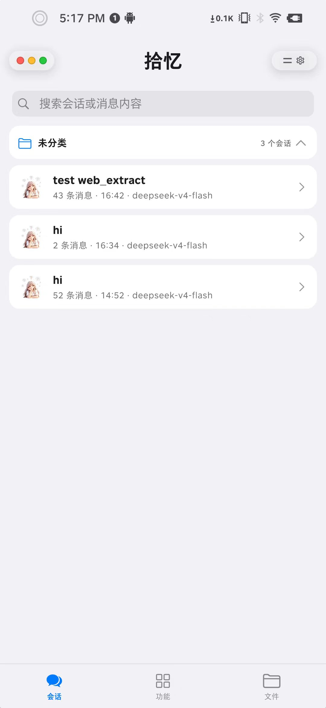
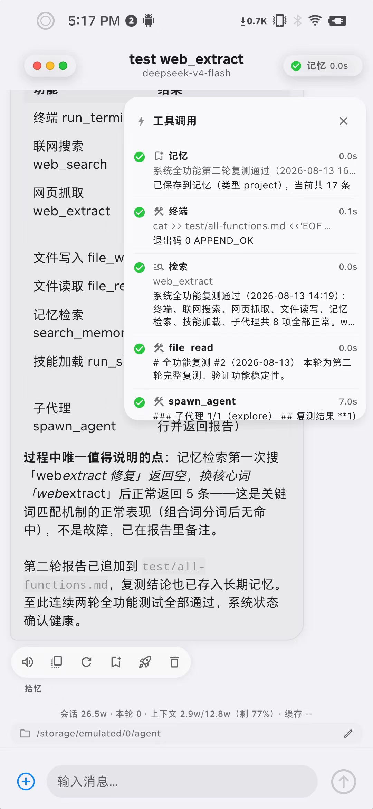
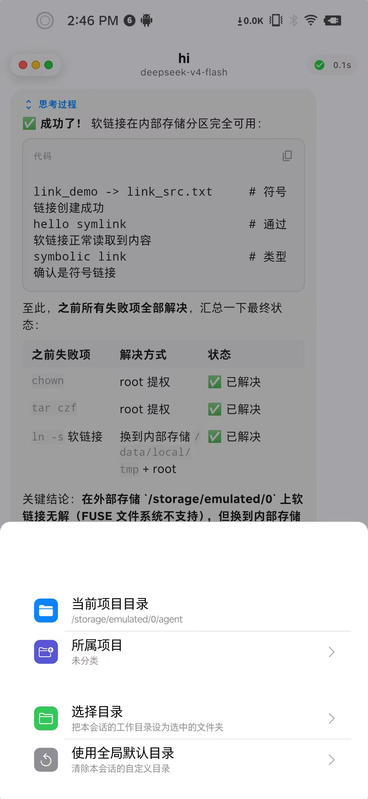
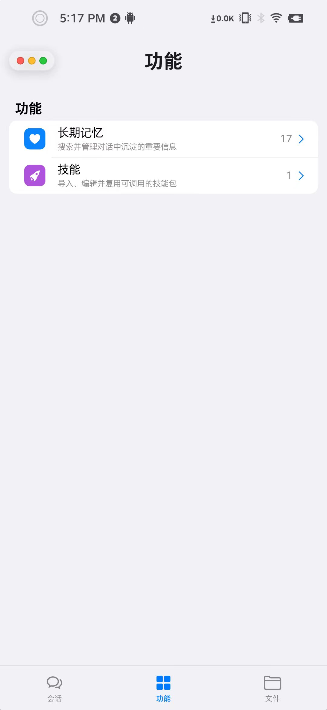
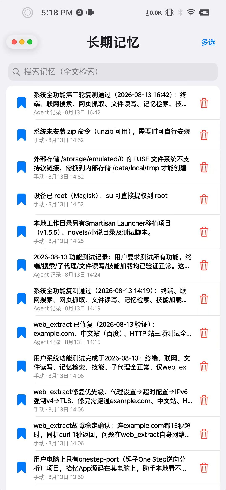
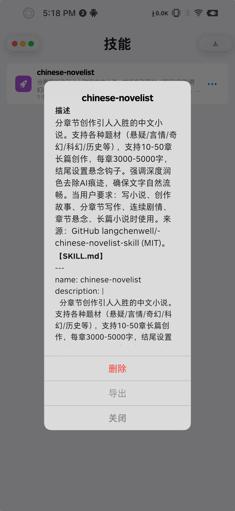
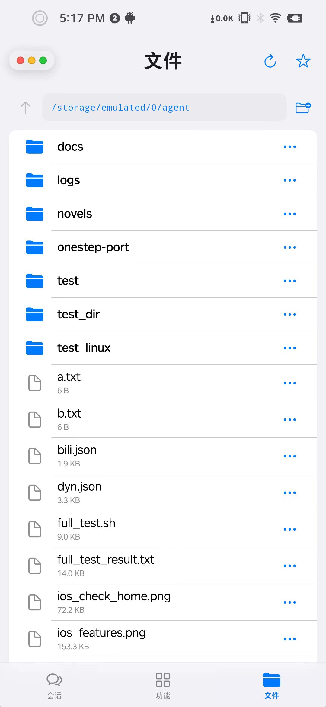
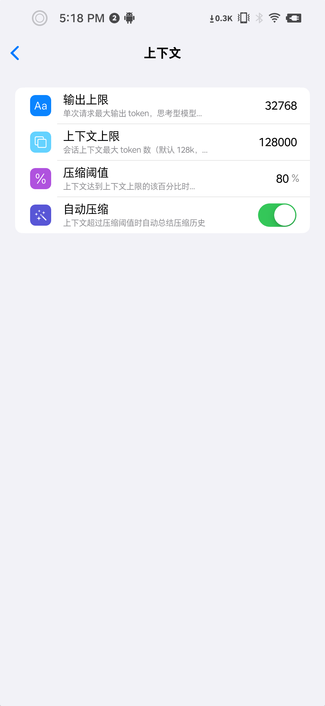

# 拾忆 ShiYi 使用教程

> 版本基线：v2.6.10（Flutter 3.x / Android 8.0+ 与 Windows 桌面）
> 适用对象：第一次装上拾忆、想知道「到底怎么用起来」的用户
> 全文 15 分钟可读完，照着做一遍即可跑通「配模型 → 建项目 → 干活 → 沉淀」的完整闭环

---

## 0. 一句话认识拾忆

拾忆不是「又一个聊天框」，而是一个**装在手机 / 电脑里的 AI 工作台**：

- **会动手**：能读写你指定目录里的文件、能执行命令（Android 内嵌 Alpine，Windows 走本机 WSL / Git Bash / pwsh / cmd）、能联网搜索。
- **有记忆**：把偏好、决定、项目背景沉淀进长期记忆，下次自动带上。
- **有流程**：技能（skill）把「一次配置、反复复用」的做事流程固定下来。
- **能分工**：子代理并行干活，群聊模拟一个团队按公司结构汇报。
- **双引擎**：拾忆本地引擎 ↔ DeepSeek Harness（DSH），会话与数据各自独立。


---

## 1. 安装与首次启动

### 1.1 Android

1. 从 [GitHub Releases](https://github.com/JIUSIS/shiyi-agent/releases) 下载 `shiyi-agent-vX.Y.Z.apk`（Android 8.0+）。
2. 直接安装。**升级时务必覆盖安装**，不要先卸载——卸载会清空 API Key、会话、记忆、群聊全部数据。
3. 首次启动会自动部署内置 Alpine 终端环境（约 4MB 资产 + 首次初始化），进度条走完再用终端。

> 覆盖安装命令（同一签名下不会清数据）：`adb install -r shiyi-agent-vX.Y.Z.apk`

### 1.2 Windows 桌面

解压 Release 压缩包后运行 `shiyi_agent.exe`。**分发时必须整目录拷贝**（exe 依赖同目录的 DLL 与 data 文件夹），不能只发一个 exe。

### 1.3 关于「终端能不能用」

Android 端终端依赖系统的执行权限环境：KernelSU / Magisk 环境开箱可用；无 root 设备可能受 SELinux 限制。拾忆会在启动时自动补齐所需策略。**不要把 root 下手动写进 rootfs 的文件当成可用环境**，所有安装都走 app 内流程。

---

## 2. 三步配好，先能说话

### 2.1 配置模型 API（必做）

`设置 → 模型 → 模型 API`



| 字段 | 填什么 |
| --- | --- |
| 接口地址 | 服务商的 Base URL，例如 `https://api.deepseek.com/v1` |
| API 密钥 | 你的 Key |
| 模型 | 模型 ID，可点「获取模型」拉列表后选择 |
| 协议 | `openai`（Chat Completions）/ `responses`（OpenAI Responses）/ `anthropic`（Messages）三选一 |

填完点**测试连接**，通了再往下走。可以保存多套 API 配置随时切换。



### 2.2 按需开启视觉模型

`设置 → 模型 → 视觉模型`：开启后可以给 AI 发图片做理解。主模型不支持视觉时，这里单独配一个能看图的模型即可。

### 2.3 打开工具调用与记忆

`设置 → 对话 → 对话与功能`

- **启用工具调用**：不开就只能纯聊天，不会读写文件、不会跑命令。
- **启用长期记忆**：对话前自动注入相关记忆与技能上下文。
- **自动沉淀记忆**：每轮对话后自动提炼重要信息入库。
- **任务完成通知**：切走会话或后台运行时，干完推送系统通知。

---

## 3. 界面导航：底部四栏

App 底部固定四栏，拾忆与 DSH 共用最后两栏（文件 / 终端）：

| 栏位 | 拾忆引擎 | DSH 引擎 | 作用 |
| --- | --- | --- | --- |
| 1 | 会话 | 工作数据 | 项目 / 会话管理 |
| 2 | 功能 | 功能 | 记忆、技能、群聊、子代理等 |
| 3 | 文件 | 文件 | 浏览 / 搜索工作目录 |
| 4 | 终端 | 终端 | 内嵌 Alpine 命令行，点画面输入 |


---

## 4. 核心用法：项目 + 会话

拾忆的组织方式是 **项目（一级入口）→ 会话**。项目管目录，会话管对话，AI 干活默认围绕项目的工作目录。

### 4.1 新建项目

1. 主页点**新建项目**，起名字并选择文件夹位置（Android 默认 `/storage/emulated/0/agent`，Windows 默认 `文档\agent`）。
2. 项目横幅**点击展开 / 收起**，展开后看到该项目下的全部会话。
3. 项目横幅**左滑**：新建会话 / 设置项目文件夹 / 重命名 / 删除。



### 4.2 会话里的高频操作

- 新建会话可单独覆盖工作目录（不设就继承项目目录）。
- 消息气泡**长按**：选择文字 / 复制 / 朗读 / 重新生成 / 保存记忆 / 保存技能。
- 会话卡片**左滑**：重命名 / 删除 / 复制会话 ID。
- 输入区上方悬浮芯片：**缓存命中率**（最左）与**子代理进度**。
- 输入区常驻**压缩按钮**：上下文太长时手动压缩，长任务的续航手段。



### 4.3 让 AI 真正干活的话术

不用背命令，说清楚「在哪儿、要什么结果」就行：

```
在当前项目目录里建一个 docs 文件夹，
把今天讨论的三个需求整理成 requirements.md，
每个需求带一句验收标准。
```

AI 会自己决定调用 `file_read` / `file_write` / `run_terminal` 等工具，工具调用过程会以胶囊形式显示在气泡里。



### 4.4 附件与视觉

支持文件 / 图片多选附件。发图前确认视觉模型已开启，否则模型只能看到文件名。

---

## 5. 群聊：让 AI 组成一个团队

入口有两处：主页会话 tab 顶部的**群聊**条，或 `功能 → 群聊`。



### 5.1 建群的最快方式：贴一张思维导图

新建 / 编辑群聊时，可以直接粘贴 **mermaid** 或字符画的思维导图，拾忆会自动识别：

- 有几个人、各自人设是什么、谁向谁汇报；
- 识别结果只替换当前编辑中的成员和标题，**不会自动保存**；
- 每个成员先套用当前默认 API 配置与模型，之后可以单独改；
- 有起步路线时可选择「全部」或「最小 N 人」。

### 5.2 公司式协作规则

- **组织是公司结构，不是全员抢答**：`reports_to` 为空的人对接你，其他人被 `@名字` 或上级安排后才发言，说完向直接上级汇报。
- 不设固定轮次上限，但同一交接环节被「打回」最多 3 次。
- 并行批次调度：同一批最多 3 个 Agent 同时生成；多个成员汇报同一位上级时合并成一次排队。
- 每个 Agent 的**思考过程单独显示在自己的气泡里**，不混进正文。

### 5.3 边界

群聊**不带官方会话工具**（没有文件 / 终端 / 子代理 / 记忆写入），成员只做对话与汇报。需要动手的活回到单聊会话里做。

---

## 6. 长期记忆与技能：把一次经验变成资产

`功能 → 长期记忆` / `功能 → 技能`



- **长期记忆**：自动沉淀偏好、决定、项目背景；支持全文检索与多选管理。也可以从消息气泡长按「保存记忆」手动入库。
- **技能**：支持导入 / 编辑 / 导出 / 删除自定义技能包。技能 = 流程，一次配置反复复用。



**在会话里用技能**：输入 `/` 会弹出技能选择器（独立 `/` 才触发，正常打斜杠不会误弹）。选中后该技能的流程会作为指令注入本轮。

典型技能：资料整理、代码分析、内容创作、报告生成、小说写作、代码审计。

---

## 7. 文件与终端

### 7.1 文件页

`底部第 3 栏`：可视化浏览 / 搜索工作目录，支持外部存储与内部存储，大目录异步加载不卡 UI。会话里出现的文件路径可直接点击，弹窗里可切换工作目录或使用全局默认目录。



### 7.2 终端页

`底部第 4 栏`：**没有独立输入框，点画面输入**。

- Android：内嵌 Alpine（`apk` 包管理，清华源优先），与 AI 的 `run_terminal` 共用同一条启动链，**不需要另装 Termux**。
- Windows：走你在 `设置 → 通用 → 终端` 选定的后端（自动 / WSL2 / Git Bash / PowerShell 7 / cmd）。
- 执行中输入仍可用；输入浅蓝、正常输出灰绿、警告黄、错误红，命令行按 token 分色。
- **双指捏合缩放字号**（下限 1、上限 28，默认 13），捏合不算点击，不会误弹键盘。
- 输入时按前缀补全内置命令，历史命令优先，未提交部分用浅色幽灵字显示。

常用第一步：

```bash
apk update
apk add python3
python3 --version
```

---

## 8. 子代理：一次派多人分头干

让 AI 使用 `spawn_agent` 按任务复杂度自行决定派几个：

- 内置四类：`explore` 只读侦查、`plan` 只读方案设计、`worker` 独立执行、`general-purpose` 兜底。
- **并行派发**：一次多个任务同时跑、互不阻塞，单个失败不影响其他，界面显示「子代理 i/N」进度。
- **动态轮数预算**：`max_turns` 1~80，简单任务 5~10、复杂任务 40~60，省时省钱。
- **写路径隔离**：并行 `worker` 各自声明 `write_paths`，越界写入会被执行层拒绝，互不覆盖文件。
- 安全设计：工具白名单、禁止递归委派、轮次上限。

点输入区上方的子代理芯片可以浮出 mini 会话，左右滑动查看每个子代理的实时进度；上滑看历史后不会自动跳回底部，只有贴底时才跟随最新。

---

## 9. DSH 引擎（DeepSeek Harness）

`设置 → 对话 → Agent 引擎`：切换「拾忆（本地引擎）」或「DeepSeek Harness」。切换后主页第一栏变成**工作数据**，底部四栏结构不变。

### 9.1 三种连接方式

| 方式 | 适用 | 说明 |
| --- | --- | --- |
| 本机 | 同一台设备 | `127.0.0.1:3080`，App 内可安装 / 启停 DSH 服务 |
| 局域网 | 同一网络里的电脑 | 填主机 + 端口（默认 3080），电脑需监听 `0.0.0.0`，手机不要填 `127.0.0.1` |
| 公网 | 远程 IP / 域名 | 填完整 URL，可选 Token |

### 9.2 本机安装

选「本机」后可看到「本地版本 / 最新版本 / 服务状态 / 网络代理」。点安装，DSH + Node 环境自动就绪；启动后可**复制 WebUI 认证地址**（注意：每次重启 DSH 后都要用新地址）。

> 局域网 / 公网连接下，App 不会去启停本机的 DSH；也请给远程 DSH 开启 `settings.mutate` / `credentials.set` 管理权限，否则只能只读浏览。

### 9.3 让 DSH 用上拾忆的 API

统一走「手机临时中转」：选中「手机临时中转 · <你的配置>」即可，App 会按会话注入中转地址并选择模型，**真实 API Key 始终留在手机上**。

- 本机 / 局域网都走手机中转（本机不依赖 Wi-Fi）；
- 公网 DSH 无法反向拨入手机，改为把 baseUrl + Key 直接写进目标 `settings.yaml` / `.credentials.yaml`，目标主机因此持有真实密钥——这是需要你知情选择的边界；可在「模型数据」页手动删除。

发送时若撞上失效 provider，App 会自动重取一次租约重试。

### 9.4 DSH 里的常用页面

- **工作数据**：工作区 + 会话。会话只能在本工作区内长按排序，不支持跨工作区搬家。
- **模型数据**：按 provider 一张卡展示，可清空命名空间与凭据。
- **插件 / 技能 / 子代理 / 预设**：`功能` tab 下按连接对象展示真实状态；本机读本地补丁文件，局域网 / 公网读远端实时清单。
- **权限按钮**（会话输入区盾牌）：选项来自服务端 schema，切换对当前会话**实时生效**（等价于官方 `/permission` 命令）。

---

## 10. 设置项速查

`设置` 页分四组：

**模型**
- 模型 API：接口地址 / 密钥 / 模型与预设
- 视觉模型：辅助看图

**对话**
- 对话与功能：工具调用 / 记忆 / 通知 / 回车发送
- 上下文：新建默认上下文长度、自动压缩开关
- Agent 引擎：拾忆 ↔ DSH 切换与连接配置

**通用**
- 外观：浅色 / 深色 / 跟随系统
- 语音：朗读语速
- 终端（仅 Windows）：自动 / WSL2 / Git Bash / PowerShell 7 / cmd
- SOCKS5 代理：`off` / `auto`（自动扫本机 Clash、V2RayN、SS 端口）/ `custom`
- 高级：温度 / 文件权限 / 系统提示词

**支持**
- 关于：版本、检查更新、功能特性
- 日志：查看运行与错误日志（排障第一入口）



---

## 11. 实战工作流示例

### 11.1 手机上的「随手记 → 归档」工作流

1. 新建项目「我的资料」，目录选 `/storage/emulated/0/agent/notes`。
2. 把随手拍的截图、零散 txt 丢进目录。
3. 会话里说：

```
读取 notes 目录下所有文件，合并去重，
按主题整理成 2026-03-整理.md，附一份目录索引。
```

4. AI 调 `file_read` / `file_write` 完成，结果在文件页可见。
5. 长按结论气泡 →「保存记忆」，下次它会记得你的归档规则。

### 11.2 桌面上的「项目体检」工作流

1. Windows 版新建项目指向代码仓库目录。
2. 让 AI 派多个 `worker` 并行：

```
派三个子代理分别检查：1) 未处理的 TODO；
2) 明显的内存泄漏风险；3) 缺失的单元测试。
每人只读不写，最后汇总成 review.md。
```

3. 子代理进度在芯片里实时可见；`explore` 只读保证不会乱改代码。
4. 结论满意后长按 →「保存技能」，固化成 `/项目体检` 技能，下次一句唤起。

### 11.3 用群聊做方案评审

1. `功能 → 群聊 → 新建`，贴一张 mermaid 组织结构图：
   ```
   graph TD
     产品经理 --> 架构师
     架构师 --> 前端
     架构师 --> 后端
   ```
2. 每个成员配好 API 与模型，人设写清楚职责。
3. 在群聊里 `@产品经理 出一版需求拆解`，其后由汇报链自动推进，每人的思考过程各自可见。

---

## 12. 常见问题

**Q：升级后数据没了？**
A：大概率是安装时被卸载重装。Android 请统一用覆盖安装；`flutter install` 在某些情况下会自动卸载重装，推荐手动 `adb install -r`。

**Q：模型一直报错 / 连不上？**
A：先看 `设置 → 支持 → 日志`。再核对协议选对没有（Responses 与 Chat 的请求体不同）、Base URL 是否需要去 `/v1`、以及是否被网关拒绝。

**Q：终端装不上基础包？**
A：Android 端终端依赖 SELinux 执行权限与链接权限；在有 root 的环境（KernelSU / Magisk）下 App 会自动补齐策略后重试。无 root 设备属平台限制。

**Q：上下文越聊越贵？**
A：看输入框上方的**缓存命中率**：命中率高=便宜，低=成本上升。长会话用输入区的压缩按钮手动压缩；自动压缩也可在 `设置 → 对话 → 上下文` 打开。

**Q：想让两个会话互相看见？**
A：会话卡片左滑「复制 ID」，把 ID 发到另一个会话，模型会用 `search_sessions` / `read_session` 找到并阅读。

**Q：AI 说它读不到文件？**
A：检查当前会话生效的工作目录（项目目录或会话覆盖目录），确认文件确实在里面；文件路径可以直接点开验证。

**Q：子代理跑飞了怎么办？**
A：停止会立即取消当前会话的请求、子代理请求与 `run_terminal` 进程。子代理带了轮次上限与工具白名单，正常不会失控。

---

## 13. 数据与隐私

- 会话、设置、长期记忆、群聊数据**默认只存在本机设备**。
- 发送给模型的内容取决于你配置的 API 服务与实际对话内容。
- API Key 保存在设备本地安全存储，不写入明文配置文件。

---

## 附：一页速查

| 我想…… | 去哪儿 |
| --- | --- |
| 配模型 | 设置 → 模型 → 模型 API |
| 建项目 / 建会话 | 主页新建项目 → 项目横幅左滑 |
| 让 AI 读写文件 / 跑命令 | 直接在会话里说；确保「启用工具调用」已开 |
| 用现成流程 | 会话里输入 `/` 选技能 |
| 把好流程存下来 | 长按消息气泡 → 保存技能 |
| 看它刚才干了什么 | 设置 → 支持 → 日志 |
| 换引擎 | 设置 → 对话 → Agent 引擎 |
| 命令行 | 底部第 4 栏（点画面输入） |
| 管记忆 | 功能 → 长期记忆 |
| 多人协作 | 功能 → 群聊 |
